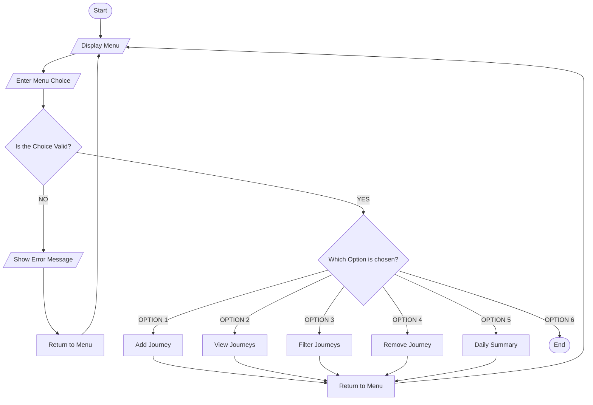
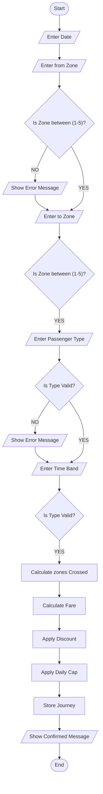
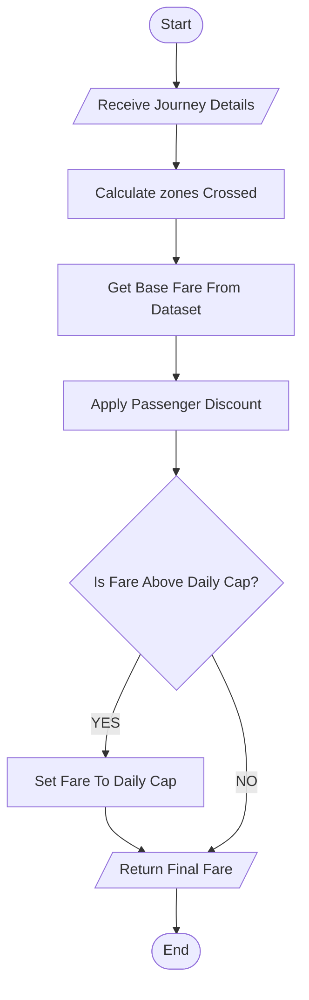
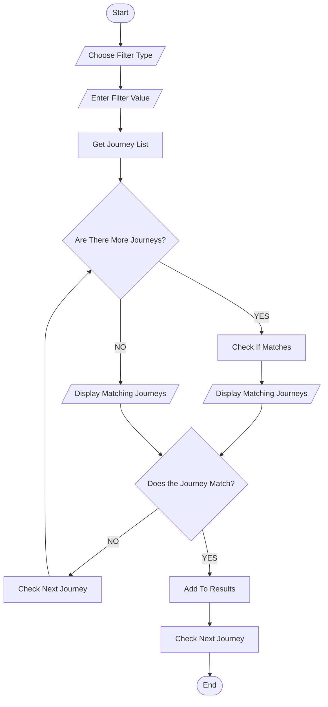
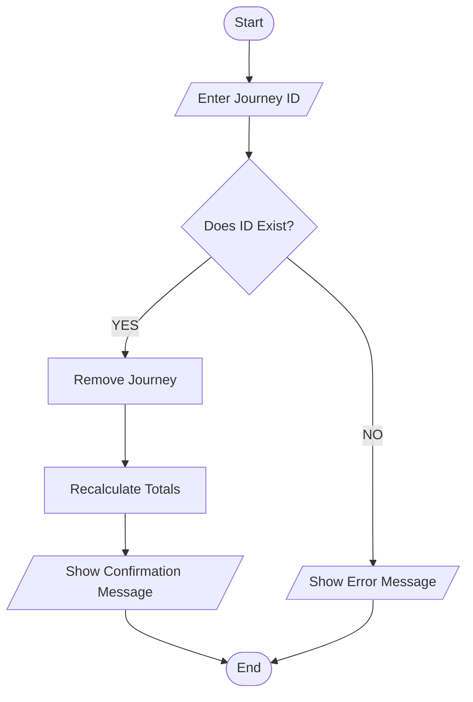
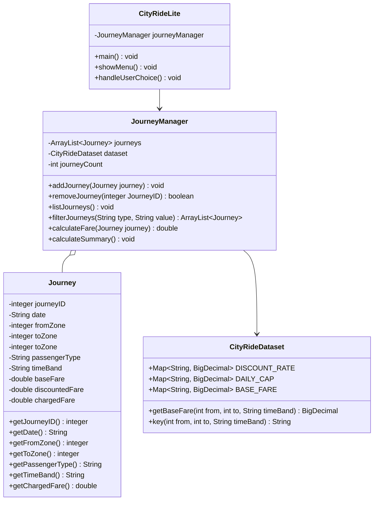

### CityRide Lite

---------------------------------------------------------

CityRide Lite is organised around the management of individual public transport journeys within a single-day session. Users can work with recorded journeys through the main menu, including viewing the journeys already stored, filtering them by passenger type, removing selected journeys, and generating a daily summary. Each journey is assigned a unique ID and contains information such as its date, travel zones, passenger type, time band and calculated fare. The system keeps these records in memory while the application is running, allowing the different journey management features to work together as part of one application.

-------------------------------------------

### Table Of Contents

--------------------------------------------------

1. [Introduction](#introduction)

2. [Analysis](#analysis)
   
   [Functional Requirements](#functional-requirements)
   
   [Non Functional Requirements](#non-functional-requirements)
   
   [Input Process Output Design](#input-process-output-design)

3. [Algorithm Design](#algorithm-design)
   
   [Main Menu Flowchart](#main-menu-flowchart)
   
   [Add Journey Flowchart](#add-journey-flowchart)
   
   [Calculate Fare Flowchart](#calculate-fare-flowchart)
   
   [Filter Journeys Flowchart](#filter-journeys-flowchart)
   
   [Remove Journey Flowchart](#remove-journey-flowchart)

4. [Class Diagram Design Overview](#class-diagram-design-overview)

5. [Testing](#testing)
   
   [Display Menu FR1](#display-menu-fr1)
   
   [Calculate Fare FR3](#calculate-fare-fr3)
   
   [Remove Journey FR6](#remove-journey-fr6)
   
   [Filter Journey FR5](#filter-journey-fr5)

6. [Evaluation](#evaluation)

7. [References](#references)

8. [Citation](#citation)

-----------------------------------------

### Introduction

------------------------------------------------------------------------------------------------------------------------------

This project involves the design and development of a console - based Java application called CityRide Lite, which is used to record and manage public transport journeys for a single day. The aim of the system is to allow users to input journey details such as travel zones, passenger type, and time band, and then calculate fares based on a fixed dataset that includes base fares, discounts, and daily caps. The system provides a range of features including adding and storing journeys, filtering and removing journeys, and generating daily summary reports. All interactions with the system are performed through a text - based menu and stores all journey data in memory for the duration of the session. This makes the program simple to use while still demonstrating important programming concepts such as input validation, control and class structures, collections, and the OOP design. The development of this system required the application of key software engineering principles, including requirements analysis, algorithm design using flowcharts, object - oriented programming (OOP), and testing of the program. 

Throughout the development process, the system was built progressively across multiple milestones, allowing for reflection, refinement, and improvement. This results in a final completion that includes program code, design documentation, testing proof, and an evaluation of how well the system meets the original requirements. This report will firstly present a detailed analysis of the program’s functional and non - functional requirements. This section includes an Input – Process - Output (IPO) table used to define the boundaries of the system and the logic required for fare calculations. Secondly, it will outline the structural design of the program through the use of flowcharts to visualize logic flow and class diagrams to illustrate the Object - Oriented Programming Structure. This is followed by a detailed section on system testing, specifically focusing on black - box testing of the Scanner class - based input methods to ensure data integrity, program stability and system functionality. Finally, the report will provide a critical evaluation of the project, assessing how effectively the final application meets the specified brief, before concluding with the full source code listing, references, and relevant appendices.

----------------------------------------------------------------------

### Analysis

----------------------------------------------

The CityRide Lite system was developed based on a detailed specification according to the functional and non - functional requirements outlined in the assignment brief. The program is required to operate as a console - based, in memory application that records public transport journeys for a single day. The main objective is to simulate a simplified public transport fare system that calculates journey costs based on predefined rules. No file storage is used, and all data is reset when the program terminates.

<u>**Functional Requirements**</u>

Functional requirements include;

- Displaying a looping main menu which allows user selection

- Adding journeys with validated input (date, zones, passenger type, time band)

- Calculating fare based on zones crossed, discounts, and daily caps

- Determining base fares using the provided dataset

- Applying passenger discounts

- Enforcing daily caps per passenger type

- Storing journeys in memory with unique IDs

- Listing journeys recorded for the day

- Filter journeys based on passenger type

- Remove a journey using its ID for validation

- Reset all stored data for a new day

- Generating daily summaries

- Exit the program safely

**<u>Non Functional Requirements</u>**

Non-functional requirements include;

- The system must use object-oriented programming principles

- Input validation and error handling to prevent invalid or incorrect data

- The program must run efficiently in a console - based interface

- Clear program structure and readability

- The system must be easy to use through a structured menu interface

**<u>Input Process Output Design</u>**

The Input – Process - Output (IPO) table was developed to clearly identify:

- The data required from the user

- The internal processing performed by the system

- The output generated for each feature

Each feature is initiated by user input (e.g., menu choice, journey details, journey ID), ensuring that the system remains user driven as required by the assignment brief.

| Feature / Task            | Inputs                                                                                                     | Processing (what the system does)                                                   | Outputs                    |
| ------------------------- | ---------------------------------------------------------------------------------------------------------- | ----------------------------------------------------------------------------------- | -------------------------- |
| **Start program**         | None (program launch)                                                                                      | Initialise data structures and running totals                                       | Main menu shown            |
| **Display menu (FR1)**    | User menu choice (1 - 5) (int)                                                                             | Validate choice and route to correct function                                       | Selected screen displayed  |
| **Add journey (FR2)**     | Date (String), from zone (int), to zone (int), passenger type (String), time band (String) - peak/off-peak | Validate inputs, calculate zones crossed, lookup fare, apply discount and daily cap | Journey added confirmation |
| **Calculate fare (FR3)**  | From zone (int), to zone (int), time band (String), passenger type (String)                                | Calculates zones crossed, get base fare, apply discount and daily cap               | Final charged fare         |
| **Store journey (FR4)**   | Journey details (Data Structure)                                                                           | Create Journey object and assign ID                                                 | Journey stored in memory   |
| **List journeys**         | View Request (Boolean: Y/N)                                                                                | Loop through journey list                                                           | Display all journeys       |
| **Filter journeys (FR5)** | Filter Criteria (Type: String, Value: String/Integer)                                                      | Search journey list                                                                 | Filtered journey list      |
| **Remove journey (FR6)**  | Journey ID (Integer)                                                                                       | Validate ID, remove journey, recalculate totals                                     | Confirmation or error      |
| **Daily summary (FR7)**   | Summary Request (Boolean: Y/N)                                                                             | Calculate totals, averages, max fare                                                | Summary report             |
| **Reset day**             | Confirmation (Boolean: Y/N)                                                                                | Clear all lists and totals                                                          | System reset message       |
| **Exit**                  | Menu choice – 5 : Exit Command (int)                                                                       | Terminate program                                                                   | Goodbye message            |

------------------------------------------------------------------------------

### Algorithm Design

------------------------------------------------------------------------------------------------------------------------------

The algorithm design for CityRide Lite was developed using structured flowcharts and a class diagram to visually demonstrate the program logic and object - oriented structure. The system was decomposed into smaller functional components to improve clarity and maintainability.

**<u>Main Menu Flowchart</u>**

The main menu flowchart represents the overall control structure of the program. The system begins execution in the main method and enters a loop that continues until the user selects the Exit option. When the program starts, the menu options are displayed and the user is prompted to enter a choice. The input is validated to ensure it is within the permitted range. 

If the input is invalid, an error message is displayed and the system returns to the menu. If valid, the corresponding method is executed (Add Journey, Filter Journeys, Remove Journey, etc.). After completing the selected function, the program returns to the main menu unless the user selects the Exit option, which terminates the program.

This flowchart ensures structured program control and continuous user interaction.



**<u>Add Journey Flowchart</u>**

The Add Journey process is the most detailed functional component of the system. The algorithm follows these steps:

- Prompt user for from zone.

- Validate zone range (1–5).

- Prompt user for to zone.

- Validate zone range.

- Prompt for passenger type.

- Validate passenger type.

- Prompt for time band.

- Validate time band.

- Calculate zones crossed.

- Retrieve base fare from dataset.

- Apply discount rate.

- Check daily cap.

- Adjust fare if necessary.

- Create Journey object.

- Store journey in memory.

- Display confirmation.

A new Journey object is created and stored in memory through the JourneyManager class. A confirmation message is displayed before returning to the main menu.

This Add Journey flowchart represents the process of recording a new journey.



**<u>Calculate Fare Flowchart</u>**

The Calculate Fare flowchart focuses specifically on fare computation logic. It separates business logic from user interaction.

The process includes:

- Receiving validated zone and passenger data.

- Calculating zones crossed.

- Looking up base fare from CityRideDataset.

- Applying discount percentage.

- Checking whether the fare exceeds the daily cap.

- Adjusting the fare if necessary.

- Returning the final charged fare.

Separating this logic into its own flowchart improves modularity and supports reusable fare calculations within the program.



**<u>Filter Journeys Flowchart</u>**

The Filter Journeys flowchart demonstrates how the system searches stored journeys based on specific criteria. The journey list is then searched using a loop. Matching journeys are displayed. If no matches are found, an appropriate message is shown. Control then returns to the main menu.

The Filter Journeys flowchart allows users to search for journeys based on passenger type. The system prompts the user for the filter value and validates the input.



**<u>Remove Journey Flowchart</u>**

The Remove Journey flowchart allows a user to delete a stored journey. The system prompts the user to enter a Journey ID. The ID is validated and the journey list is searched. If the journey is found, it is removed from memory and totals are recalculated where necessary. A confirmation message is displayed. If the ID does not exist, an error message is shown.

This ensures controlled data management within the system.

The process includes:

- Entering Journey ID.

- Validating that the ID exists.

- Removing the journey from storage.

- Recalculating totals.

- Displaying confirmation or error message.



-------------------------------------------------

### Class Diagram Design Overview

----------------------------------------------------------

The class diagram demonstrates the object - oriented structure of the system. The application consists of four primary classes:

- CityRideLite (Controls program execution and user interaction).

- JourneyManager (manages journey collection and fare logic).

- Journey (represents individual journey data).

- CityRideDataset (provides fixed fare and discount data).



**The relationships are as follows:**

The CityRideLite class has an association relationship with JourneyManager, as it calls its methods. The JourneyManager class has an aggregation relationship with Journey, as it stores multiple Journey objects. The JourneyManager also depends on the CityRideDataset class for fare calculation data.

- CityRideLite → uses → JourneyManager

- JourneyManager → aggregates → Journey (1 to many)

- JourneyManager → depends on → CityRideDataset

Encapsulation is applied by keeping attributes private and exposing only necessary methods.

------------------------------------

### Testing

---------------------------------------

Black box testing was conducted on all user input methods, particularly only methods for the Scanner class. Black Box Testing will be based on the Functional Requirements.

So we test:

- Menu input

- Zone input

- Passenger type input

- Time band input

- Remove journey input

- Filter input

When we do black box testing we test inputs and outputs and not the internal code logic.

**<u>Black Box Testing Table</u>**

*Functional Requirement:*

**Display Menu FR1**

| Test No. | Input                          | Expected Output          | Actual Output                 | Result |
| -------- | ------------------------------ | ------------------------ | ----------------------------- | ------ |
| **1**    | 2                              | Add Journey screen shown | Add Journey prompts displayed | Pass   |
| **2**    | 1                              | Fare table displayed     | Fare table displayed          | Pass   |
| **3**    | 9                              | Invalid option message   | "Invalid option" shown        | Pass   |
| **4**    | -1                             | Invalid option message   | "Invalid option" shown        | Pass   |
| **5**    | Valid zones (1-3), ADULT, PEAK | Journey stored           | Journey stored successfully   | Pass   |
| **6**    | Zone 6                         | Error message            | Validation message shown      | Pass   |
| **7**    | Invalid passenger type         | Error message            | Input rejected                | Pass   |

<u>**Output**</u>

Invalid option: -1

```textile
Starting program...
Welcome!

--- CityRide Lite ---
---------------------
1. View Fare Table
2. Add Journey
3. View Journeys
4. Filter Journeys
5. Remove Journey
6. Daily Summary
7. Exit
--------------------
Enter choice: -1
--------------------
Invalid option.
```

Invalid option: 9

```textile
Starting program...
Welcome!

--- CityRide Lite ---
---------------------
1. View Fare Table
2. Add Journey
3. View Journeys
4. Filter Journeys
5. Remove Journey
6. Daily Summary
7. Exit
--------------------
Enter choice: 9
--------------------
Invalid option.
```

View Fare Table

```textile
Starting program...
Welcome!

--- CityRide Lite ---
--------------------
1. View Fare Table
2. Add Journey
3. View Journeys
4. Filter Journeys
5. Remove Journey
6. Daily Summary
7. Exit
--------------------
Enter choice: 1

--- Fare Table ---

Time Band: PEAK
-----------------------------------
From Zone 1 to Zone 1 : £2.50
From Zone 1 to Zone 2 : £3.20
From Zone 1 to Zone 3 : £3.80
From Zone 1 to Zone 4 : £4.40
From Zone 1 to Zone 5 : £5.00
From Zone 2 to Zone 1 : £3.20
From Zone 2 to Zone 2 : £2.30
From Zone 2 to Zone 3 : £3.10
From Zone 2 to Zone 4 : £3.80
From Zone 2 to Zone 5 : £4.50
From Zone 3 to Zone 1 : £3.80
...
From Zone 4 to Zone 5 : £2.40
From Zone 5 to Zone 1 : £4.20
From Zone 5 to Zone 2 : £3.80
From Zone 5 to Zone 3 : £3.10
From Zone 5 to Zone 4 : £2.40
From Zone 5 to Zone 5 : £1.50

--- Discount Rates ---
ADULT Discount: 0.00%
STUDENT Discount: 25.00%
CHILD Discount: 50.00%
SENIOR_CITIZEN Discount: 30.00%

--- Daily Caps ---
ADULT Daily Cap: £8.00
STUDENT Daily Cap: £6.00
CHILD Daily Cap: £4.00
SENIOR_CITIZEN Daily Cap: £7.00
--------------------
```

**Calculate Fare FR3**

| Test No. | Input               | Expected Output   | Actual Output          | Result |
| -------- | ------------------- | ----------------- | ---------------------- | ------ |
| **8**    | Zone 1-3 PEAK ADULT | Correct base fare | Correct fare displayed | Pass   |
| **9**    | STUDENT discount    | Fare reduced 25%  | Correct reduced fare   | Pass   |
| **10**   | Daily cap exceeded  | Fare capped       | Cap applied correctly  | Pass   |

**Remove Journey FR6**

| Test No. | Input      | Expected Output | Actual Output        | Result |
| -------- | ---------- | --------------- | -------------------- | ------ |
| **11**   | Valid ID   | Journey removed | Removal confirmation | Pass   |
| **12**   | Invalid ID | Error message   | ID not found message | Pass   |

**Filter Journey FR5**

| Test No. | Input                  | Expected Output           | Actual Output         | Result |
| -------- | ---------------------- | ------------------------- | --------------------- | ------ |
| **13**   | Filter ADULT           | Only adult journeys shown | Correct filtering     | Pass   |
| **14**   | Filter with no matches | No journeys found         | Correct message shown | Pass   |

**<u>Output</u>**

```textile
--- CityRide Lite ---
--------------------
1. View Fare Table
2. Add Journey
3. View Journeys
4. Filter Journeys
5. Remove Journey
6. Daily Summary
7. Exit
--------------------
Enter choice: 2
Enter passenger name: Deborah
--------------------
Enter from zone (1-5): 3
--------------------
Enter to zone (1-5): 2
--------------------
ADULT
STUDENT
CHILD
SENIOR_CITIZEN
Passenger type: student
--------------------
PEAK
OFF_PEAK
Time band: peak

--------------------
Journey added successfully.
Fare charged: £2.3250
--------------------
Enter choice: 5

--------------------
Passenger Name: Deborah
Journey ID: 1
From Zone: 3
To Zone: 2
Passenger Type: STUDENT
Zones Crossed: 1
Time Band: PEAK
Fare: £2.3250
--------------------
Enter Journey ID to remove: 1
Journey removed.

--- CityRide Lite ---
--------------------
1. View Fare Table
2. Add Journey
3. View Journeys
4. Filter Journeys
5. Remove Journey
6. Daily Summary
7. Exit
--------------------
Enter choice: 5
No journeys available to remove.
```

--------------------------------------

### Evaluation

--------------------------------

The CityRide Lite system successfully meets the majority of the functional requirements outlined in the assignment brief. The program allows users to add, store, filter, remove, and summarise journeys through a structured console interface. Fare calculations are correctly performed using the provided dataset, including application of base fares, passenger discounts, and daily caps. The system also demonstrates effective use of object-oriented principles such as encapsulation, separation of concerns, and class interaction.

It successfully:

- Implements full journey storage

- Applies discounts correctly

- Enforces daily caps accurately

- Validates inputs robustly

- Provides detailed summaries

- Prevents invalid removals

One of the strengths of the program is its modular design. The use of separate classes (CityRideLite, JourneyManager, Journey, and CityRideDataset) improves maintainability and readability. The inclusion of enums and BigDecimal ensures accurate financial calculations and prevents floating - point rounding errors. The addition of the fare table viewing feature also improves transparency and usability.

However, there are some limitations. The system stores journeys in memory only, meaning data is lost when the program exits. The Input validation could be further strengthened to prevent unexpected crashes from invalid data types. Additionally, the console - based interface limits user experience compared to a graphical interface (GUI).

In future improvements, the system could be extended by:

- Saving journeys to a file or database

- Implementing a graphical user interface (GUI)

- Improving input validation with exception handling

- Improving reporting with formatted summary tables

Overall, the program effectively satisfies the core requirements and demonstrates strong understanding of Java programming concepts, algorithm design, and structured software development.

-----------------------------------------------------

### References

--------------------------

Namma (n.d.). Namma-Metro-Trip-Planner. Retrieved from: https://github.com/mueezmamoon/Namma-Metro-Trip-Planner [Accessed 28 January 2026].    

Oracle Corporation (n.d.). Class Scanner. Retrieved from: https://docs.oracle.com/javase/8/docs/api/java/util/Scanner.html [Accessed 5 February 2026].

GeeksforGeeks (2026, January). Classes and Objects in Java. Retrieved from: https://www.geeksforgeeks.org/java/classes-objects-java [Accessed 8 February 2026].

GeeksforGeeks (2026, February). ArrayList in Java. Retrieved from: https://www.geeksforgeeks.org/java/arraylist-in-java [Accessed 8 February 2026].

GeeksforGeeks (2025, July). BigDecimal divide() Method in Java with Examples. Retrieves from: https://www.geeksforgeeks.org/java/bigdecimal-divide-method-in-java-with-examples/ [Accessed 13 February 2026]

GeeksforGeeks (2025). Array of Objects in Java. Retrieved from: https://www.geeksforgeeks.org/array-of-objects-in-java/ [Accessed 13 February 2026].

GeeksforGeeks (2025). Encapsulation in Java. Retrieved from: https://www.geeksforgeeks.org/encapsulation-in-java/ [Accessed 13 February 2026].

Oracle (n.d.). Providing Constructors for Your Classes. Retrieved from: https://docs.oracle.com/javase/tutorial/java/javaOO/constructors.html [Accessed 13 February 2026].

Oracle (2014). Enum Types. Retrieved from: https://docs.oracle.com/javase/tutorial/java/javaOO/enum.html [Accessed 18 February 2026].

------------------------------------

### Citation

-------------------------------------

***<u>IY4113 FInal</u>***

| Assessment Details | Please Complete All Details                                       |
| ------------------ | ----------------------------------------------------------------- |
| Group              | B                                                                 |
| Module Title       | Applied Software Engineering using Object Orientiated Programming |
| Assessment Type    | Java Fundamentals 1                                               |
| Module Tutor Name  | Jonathan Shore                                                    |
| Student Name       | Deborah Mbithi                                                    |
| Student ID Number  | P510008                                                           |

- [x] *I confirm that this assignment is my own work. Where I have referred to academic sources, I have provided in-text citations and included the sources in
  the final reference list.*

- [x] *Where I have used AI, I have cited and referenced appropriately.
