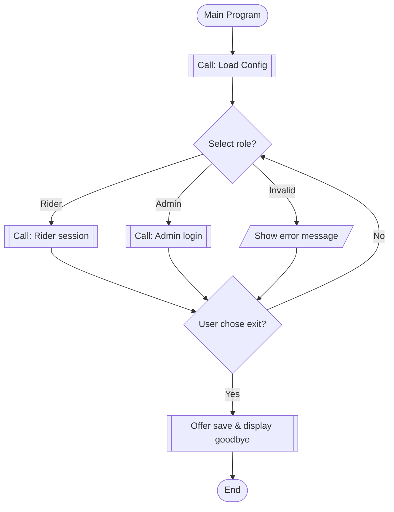
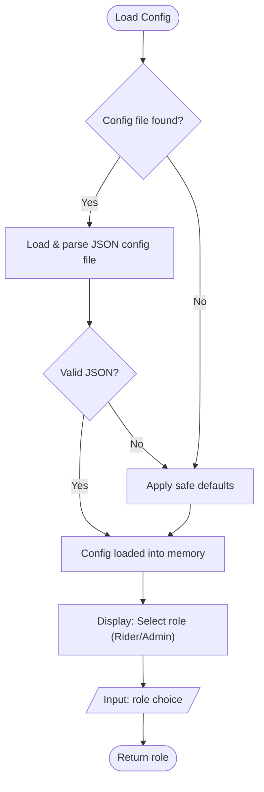
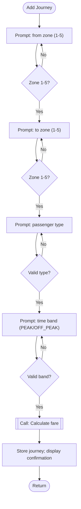
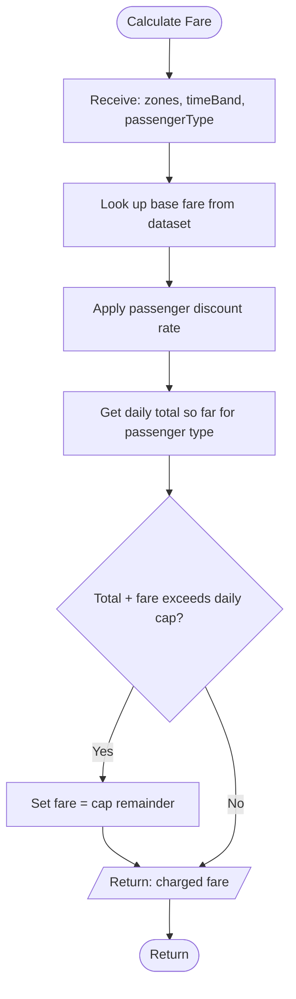
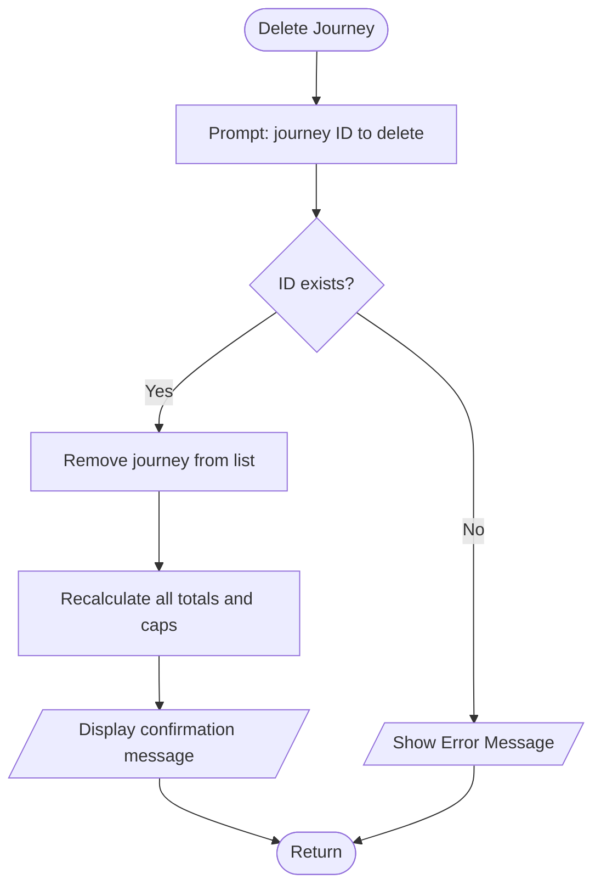
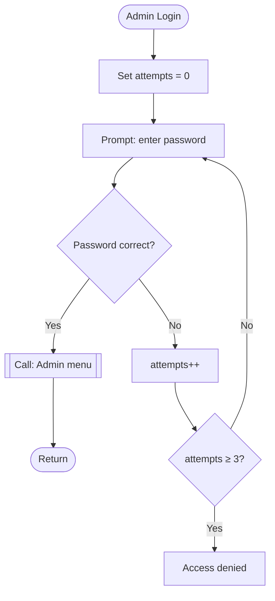
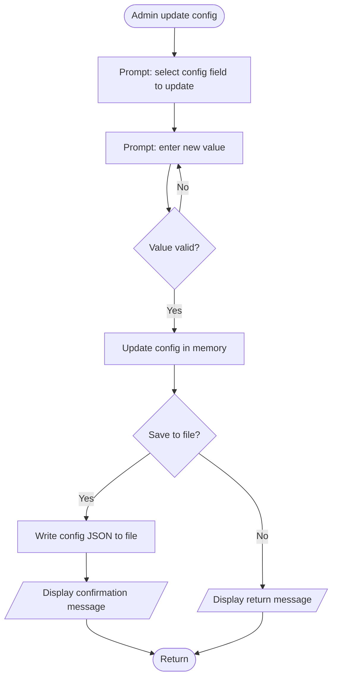
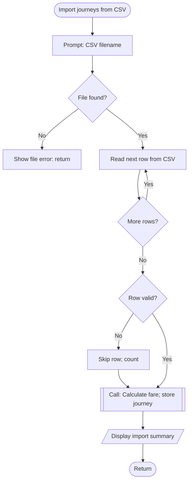

### CityRide Lite - Enhanced

--------------------------------------------------------

CityRide Lite Part 2 is structured around two user roles: Rider and Admin. Riders can create and manage their profiles, add and edit journeys, remove journeys, filter journey records and view their daily travel information. Each journey stores details such as its ID, date, travel zones, time band, passenger type and fare information. 

The application also includes an administration area where authorised users can manage fare and system settings. Journey and summary information can be imported or exported using CSV files, while rider profiles and system configuration are handled through JSON files. The program is divided into classes such as JourneyManager, RiderProfile, FareCalculator, ConfigManager and FileManager, with each handling a specific part of the system.

------------------------------------------------

### Table Of Contents

-----------------------------------------------------------

1. [Introduction](#introduction)

2. [Analysis](#analysis)
   
   [Core Program Functionality](#core-program-functionality)

3. [Input Process Output Table](#input-process-output-table)

4. [Algorithm Design](#algorithm-design)
   
   [Main Menu](#main-menu)
   
   [Load Config Subroutine](#load-config-subroutine)
   
   [Add Journey Subroutine](#add-journey-subroutine)
   
   [Calculate Fare Subroutine](#calculate-fare-subroutine)
   
   [Delete Journey Subroutine](#delete-journey-subroutine)
   
   [Admin Login Subroutine](#admin-login-subroutine)
   
   [Admin Update Config Subroutine](#admin-update-config-subroutine)
   
   [Import Journeys from CSV Subroutine](#import-journeys-from-csv-subroutine)

5. [Class Structure](#class-structure)

6. [Testing](#testing)

7. [Evaluation](#evaluation)
   
   [Does the Program Meet the Requirements](#does-the-program-meet-the-requirements)
   
   [Strengths of the Program](#strengths-of-the-program)
   
   [Weaknesses of the Program](#weaknesses-of-the-program)
   
   [Areas for Improvement](#areas-for-improvement)
   
   [Lessons Learnt](#lessons-learnt)

8. [References](#references)

9. [Citation](#citation)

---------------------------------------------------------

### Introduction

----------------------------------

This report presents the design, development, testing, and evaluation of **CityRide Lite Part 2**, a text - based Java application created using Object - Oriented Programming module. The project builds upon foundational programming concepts and applies structured software engineering practices to deliver a functional and scalable system. It demonstrates the practical use of OOP principles to solve a real-world transport fare problem. The application has been carefully developed to ensure clarity, maintainability, and usability as a significant advancement from its initial version. Overall, it reflects a progression from basic implementation to a more refined and complete software solution.

The objective of Part 2 was to extend the Part 1 system into a more advanced and realistic transport fare companion. Unlike the earlier version, which operated as a single session, in memory program, this version introduces persistent file storage, multiple user roles, and enhanced system functionality. Riders can manage profiles, track journeys, and generate reports, while Admins can configure fares and system rules through a secure interface. Additional features such as **JSON** data storage, **CSV import/export**, and dynamic fare recalculation improve both flexibility and accuracy. The system maintains core fare logic while ensuring consistency through validation and recalculation mechanisms. This report further explores requirements analysis, design decisions, testing strategies, and an overall evaluation of the system.

--------------------------------

### Analysis

------------------------------------

The aim of this program is to develop a console - based Java application named CityRide Lite, designed to record and manage public transport journeys within a single day. The system enables users to enter key journey details such as passenger name, travel zones, passenger category, and time band. Using a predefined fare structure that includes base fares, discounts, and daily caps, the application calculates the total cost of each journey accurately. **CityRide Lite Part 2** expands on the initial version developed in Part 1. While the earlier version operated as a single - session, in memory system, this updated version introduces a more advanced and persistent transport management solution. It incorporates multiple user roles and allows data to be stored between sessions. Users can now create and manage profiles, record journeys over time, and rely on configurable transport rules to calculate fares, making the system more flexible and realistic.

To improve overall functionality and user experience, several enhancements have been added. These include the ability to filter journeys based on different criteria, calculate totals according to passenger type, reset journey records for a new day, and enforce stronger input validation. The system also generates more detailed outputs, such as journey summaries and the number of zones travelled, providing clearer insights for users. Furthermore, the application supports two main roles: Rider and Admin. Riders can manage personal profiles, add and organise journeys, import and export data using CSV files, and generate end of day reports. All relevant data is stored persistently using **JSON** and **CSV** formats. The Admin role, secured with a password, allows authorised users to modify fare settings such as base fares, discounts, daily caps, and peak travel periods, with validation checks to ensure accuracy. The original fare calculation method remains in place, factoring in zones travelled and time bands, while applying discounts and caps automatically. Overall, the program demonstrates advanced concepts such as file handling, data validation, role - based access control, and dynamic recalculation within a structured and user-friendly console interface.

#### **<u>Core Program Functionality</u>**

**Role Selection:** On launch, the user chooses between the Rider and Admin roles. This determines which menu and features are accessible. If Rider is selected; Load the RiderMenu, If Admin is selected; Prompt for a password. For Example, user enters "Admin". System asks: "Enter Admin Password:". User enters "CityRide2026". If correct, access is granted; otherwise, return to the main role selection.

**Configuration Loading:** The system loads its fare rules, discounts, daily caps, and peak time windows from a JSON configuration file (e.g config.json) file at startup. If the file is missing, safe default values are used automatically.

**Rider Profile Management:** A Rider can create a new profile, save it to a JSON file, or load a previously saved profile. The profile stores the Rider's name, passenger type, and default payment option. A user named "Deborah" saves her profile. Next time she uses the app, she selects "Load Profile," and the system automatically sets the Passenger Type to "Student" without her having to type it again.

**Journey Management:** Riders can add journeys manually (entering zones, time band, and passenger type), edit existing journeys, or delete journeys with automatic recalculation of totals and caps. Journeys can also be imported in bulk from a CSV file e.g weekly_commute.csv.

**Fare Calculation:** The system calculates fares using the same dataset rules as Part 1: base fare by zone pair and time band, passenger discount applied, and daily cap enforced per passenger type.

**End of Day Summary:** The system produces a detailed summary that includes total journeys, total cost, average cost per journey, the most expensive journey (by ID), whether the daily cap was reached, savings compared to uncapped fares, and category counts (peak vs off - peak, counts per zone pair).

**Export:** The summary and journey list can be exported as both a CSV report (line items) and a human - readable text file. File names include the date and rider name for clear identification.

**Admin Menu:** Password protected access allows an Admin to view the active configuration and add, update, or delete fare rules, discounts, daily caps, and peak time windows. All input is validated before saving.

**Save on Exit:** When the Rider exits, the system offers to save the current day's profile and journeys to JSON so they can be continued in a future session.

*In summary;*

**Rider Features:**

- Create, load, and save rider profile (JSON)

- Add, edit, delete journeys

- Export journeys and reports (CSV + text)

- View running totals and summaries

- End of day report generation

**Admin Features:**

- Login with password

- View system configuration

- Add/update/delete (Base fares, Discounts, Daily caps & Peak time windows)

- Validate all inputs before saving

**System Features:**

- Load config file at startup

- Use default values if file missing

- Apply fare rules (Base fare, Discounts & Daily caps)

- Store data using (JSON (profiles/config) & CSV (journeys/reports))

**System Constraints**

- **Two roles only:** The system supports exactly two roles; Rider and Admin. Role is selected at startup.

- **Console - based interface:** All interaction is through a text menu driven console. No graphical interface is provided.

- **File - based persistence:** Profiles and configuration are stored as JSON; journeys and reports are stored as CSV. No database is used.

- **Config file dependency:** If the configuration JSON file is absent, the system defaults to safe built-in values rather than crashing.

- **Fixed passenger types:** Valid types are ADULT, STUDENT, CHILD, and SENIOR CITIZEN (as defined in CityRideDataset).

- **Fixed time bands:** Journeys must be either PEAK or OFF_PEAK.

- **Zone range 1 - 5:** From and to zones must be integers between 1 and 5 inclusive.

- **Daily caps per passenger type**: Each passenger type has its own cap; once reached, further journeys cost £0.

- **Admin password required:** The admin menu cannot be accessed without the correct password.

- **All admin changes validated:** No update to the config is saved unless it passes validation.

- **Dynamic recalculation on delete:** Deleting or undoing a journey triggers a full recalculation of totals and caps.

- **Unique journey IDs:** Each journey is assigned a unique ID for the session, used when editing or deleting.

----------------------------------------------------

### Input Process Output Table

--------------------------------

| **Feature/Task**           | **Inputs**                                                                                      | **Processing**                                                                                                                                    | **Outputs**                                                  |
| -------------------------- | ----------------------------------------------------------------------------------------------- | ------------------------------------------------------------------------------------------------------------------------------------------------- | ------------------------------------------------------------ |
| Start Program              | None (program launch)                                                                           | Load config from JSON; if missing, apply safe defaults; initialise data structures                                                                | Config loaded; role selection menu shown                     |
| Select Role                | Role choice: RIDER or ADMIN (String)                                                            | Validate input; route to Rider session or Admin login                                                                                             | Appropriate menu displayed                                   |
| Admin Login                | Password (String)                                                                               | Compare input against stored password; grant or deny access; count attempts                                                                       | Admin menu shown or access denied message                    |
| Load Config                | Config file (JSON)                                                                              | Parse JSON; populate base fares, discounts, caps, peak windows in ConfigManager                                                                   | System configured; confirmation message                      |
| Create Rider Profile       | Name (String), passenger type (String), default payment (String)                                | Validate inputs; create RiderProfile object                                                                                                       | Profile created in memory                                    |
| Save Rider Profile         | Confirmation to save (Boolean)                                                                  | Serialise RiderProfile to JSON; write to file                                                                                                     | JSON profile file saved                                      |
| Load Rider Profile         | Profile filename or name (String)                                                               | Read JSON file; parse into RiderProfile object                                                                                                    | Profile loaded into session                                  |
| Add Journey                | From zone (int), to zone (int), time band (String), passenger type (String), date/time (String) | Validate all inputs; calculate zones crossed; look up base fare; apply discount; check and apply daily cap; assign unique ID;re journey           | Journey stored; fare and cap status displayed                |
| Edit Journey               | Journey ID (int), field to edit (String), new value (String/int)                                | Validate ID exists; validate new value; update journey; recalculate all totals and caps                                                           | Journey updated; updated totals displayed                    |
| Delete Journey             | Journey ID (int)                                                                                | Validate ID exists; remove journey; recalculate all totals and caps                                                                               | Confirmation message; updated totals displayed               |
| Import Journeys from CSV   | CSV filename (String)                                                                           | Read CSV file; parse each row; validate each journey; calculate fares; add to journey list                                                        | Journeys imported; count of imported/rejected journeys shown |
| Export Journeys to CSV     | Confirmation to export (Boolean)                                                                | Format all journeys as CSV rows; write to file with date and rider name                                                                           | CSV file saved; file path shown                              |
| View Journey List          | View request (Boolean)                                                                          | Loop through all stored journeys; format each for display                                                                                         | All journeys displayed with IDs, zones, fare, cap status     |
| Filter Journeys by Type    | Passenger type (String)                                                                         | Filter journey list by matching passenger type; format for display                                                                                | Matching journeys displayed                                  |
| Calculate Fare             | From zone (int), to zone (int), time band (String), passenger type (String)                     | Calculate zones crossed; look up base fare from dataset; apply passenger discount; check daily cap; return final charged fare                     | Final fare displayed; cap notification if relevant           |
| View Running Totals        | View request (Boolean)                                                                          | Sum all journey fares for current session; compare to cap                                                                                         | Total cost, cap reached status, savings displayed            |
| End-of-Day Summary         | Summary request (Boolean)                                                                       | Count journeys; sum total/average cost; find most expensive journey ID; calculate savings vs uncapped fares; countk/off-peak; count per zone pair | Detailed summary displayed on screen                         |
| Export Summary to CSV      | Confirmation (Boolean)                                                                          | Format summary data as CSV with line items; include rider name and date in filename                                                               | CSV report file saved                                        |
| Export Summary to Text     | Confirmation (Boolean)                                                                          | Format summary as human readable text; include rider name and date in filename                                                                    | Text summary file saved                                      |
| Admin View Config          | View request (Boolean)                                                                          | Read active configuration from memory                                                                                                             | All fare rules, discounts, caps, and peak windows displayed  |
| Admin Add/Update Fare Rule | From zone (int), to zone (int), time band (String), new fare (BigDecimal)                       | Validate all fields; check fare is positive; update config in memory                                                                              | Confirmation or detailed validation error message            |
| Admin Update Discount      | Passenger type (String), new discount rate (BigDecimal)                                         | Validate passenger type; validate discount is between 0.00 and 1.00; update config                                                                | Confirmation or validation error                             |
| Admin Update Daily Cap     | Passenger type (String), new cap (BigDecimal)                                                   | Validate passenger type; validate cap is positive; update config                                                                                  | Confirmation or validation error                             |
| Save Config                | Confirmation to save (Boolean)                                                                  | Save config to JSON; write to file                                                                                                                | JSON config file saved; confirmation shown                   |
| Save and Exit              | Exit confirmation (Boolean)                                                                     | Offer to save profile and journeys; save to JSON if confirmed; close scanner                                                                      | Farewell message; files saved if chosen                      |

-----------------------------------------------------

### Algorithm Design

------------------------------------------------------

The algorithm design for CityRide Lite Part 2 uses flowcharts to represent each major subroutine. The flowcharts follow standard notation: rounded rectangles for start/end terminals, rectangles for processes, parallelograms for input/output operations, and diamonds for decisions. Subroutines are shown with their own named terminal at the top, and flow returns to the calling routine via a Return terminal at the bottom. This section describes the logic of each algorithm in prose form.

#### **Main Menu**

On program launch, the system calls the Load Config subroutine to read the JSON configuration file. If the file is found and valid, the config is loaded into memory. If it is missing or corrupted, safe default values are applied automatically. The system then displays the role selection menu. The user enters RIDER or ADMIN. If RIDER is selected, the Rider Session subroutine is called. If ADMIN is selected, the Admin Login subroutine is called. Any other input shows an error and re - displays the menu. The loop continues until the user enters EXIT.

#### **Load Config Subroutine**

The subroutine checks whether the config JSON file exists. If found, it loads and parses the file into the ConfigManager, populating the base fare, discount rate, and daily cap maps. If the file is not found or is invalid, the system applies built-in default values and continues without crashing. A confirmation or warning message is displayed. The subroutine then returns to the caller.

#### **Add Journey Subroutine**

The user is prompted for: from zone (validated as integer 1-5), to zone (validated as integer 1-5), time band (validated as PEAK or OFF_PEAK), and passenger type (validated against the four allowed types). Each input is validated in a loop that re-prompts on invalid input. Once all inputs are valid, the Calculate Fare subroutine is called. A Journey object is created and stored. A confirmation message showing the base fare, discount, and charged fare is displayed, and the subroutine returns.

#### **Calculate Fare Subroutine**

The subroutine receives from zone, to zone, time band, and passenger type as parameters. It looks up the base fare from the ConfigManager using the zone pair and time band key. It then retrieves the discount rate for the passenger type and calculates the discount amount. The fare after discount is computed. The subroutine then retrieves the running total charged so far for this passenger type and checks whether adding the discounted fare would exceed the daily cap. If it would exceed the cap, the charged fare is reduced to the remaining cap allowance. If the running total already equals or exceeds the cap, the charged fare is set to zero. The final charged fare is returned alongside the base fare and discount applied.

#### **Delete Journey Subroutine**

The user is prompted for a journey ID. If the ID does not exist in the journey list, an error message is displayed and the subroutine returns without making any changes. If the ID is found, the journey is removed from the list. The recalculate totals process then iterates through all remaining journeys in order, recalculating each fare from scratch using running totals to ensure daily cap logic is correctly reapplied. A confirmation message is displayed and the subroutine returns.

#### **Admin Login Subroutine**

The attempt counter is set to zero. The user is prompted to enter the admin password. If the password is correct, the Admin Menu subroutine is called and control returns from it. If incorrect, the attempt counter is incremented. If the counter reaches three, access is denied and the subroutine returns to the role selection menu. Otherwise, the user is re-prompted for the password, showing the number of remaining attempts.

#### **Admin Update Config Subroutine**

The admin selects which configuration field to update: base fare, discount rate, daily cap, or peak window. The system prompts for the relevant input fields. All inputs are validated before any change is made. If any field fails validation, a clear error message is shown and no changes are saved. If all inputs pass validation, the in-memory configuration is updated. The admin is then offered the option to save the updated configuration to the JSON file. A confirmation or error message is displayed accordingly.

#### **Import Journeys from CSV Subroutine**

The user is prompted for a CSV filename. The system attempts to open the file. If the file is not found, an error message is shown and the subroutine returns. For each row in the file, the system validates the number of columns and each individual field. If a row is invalid, it is skipped and counted as rejected. If valid, the Calculate Fare subroutine is called and a journey object is created and added to the list. After all rows are processed, a summary of imported and rejected rows is displayed and the subroutine returns.

-------------------------------------------------------------

### Class Structure

---------------------------------------------

The class diagram for CityRide Lite Part 2 shows the object-oriented structure of the system. The main classes and their relationships are as follows:

- **CityRideLite** - the main entry point. Handles role selection and routes to RiderSession or AdminSession. Associates with both session classes.

- **RiderSession** - manages the Rider menu loop. Associates with JourneyManager, RiderProfile, FileManager, FareCalculator, and ConfigManager.

- **AdminSession** - manages the Admin menu loop. Associates with ConfigManager.

- **RiderProfile** - stores rider name, passenger type, and default payment option. Contains getters and setters.

- **JourneyManager** - manages the list of Journey objects (ArrayList). Handles add, edit, delete, filter, recalculate totals, and summary calculations. Aggregates Journey (one-to-many).

- **Journey** - stores all journey data including ID, date, zones, time band, passenger type, base fare, discount applied, and charged fare.

- **FareCalculator** - calculates the charged fare given journey inputs, applying discount and daily cap logic. Associates with ConfigManager.

- **ConfigManager** - loads, holds, and saves the system configuration using HashMaps for base fares, discounts, and caps. Reads/writes JSON.

- **FileManager** - handles all file I/O: JSON read/write for profiles and config, CSV import/export for journeys, text and CSV export for summaries.

- **CityRideDataset** - unchanged from Part 1. A static constants class providing the base fare data structure.

***Relationships used:*** solid line with open arrowhead = Association (uses/calls); diamond with open arrowhead = Aggregation (has-a, can exist independently); no inheritance is used as no class extends another in this design.

```mermaid
classDiagram
    class CityRideLite {
        -Scanner scanner
        +main(args: String[]) void
        +showBanner() void
        +showRoleMenu() void
        +loadConfig() void
    }

    class RiderSession {
        -Scanner scanner
        -ConfigManager configManager
        -FareCalculator fareCalculator
        -JourneyManager journeyManager
        -FileManager fileManager
        -RiderProfile profile
        +start() void
        +handleAddJourney() void
        +handleRemoveJourney() void
        +handleExportJourneys() void
        +handleImportJourneys() void
        +showRunningTotals() void
    }

    class AdminSession {
        -Scanner scanner
        -ConfigManager configManager
        +start() void
        +attemptLogin() boolean
        +showAdminMenu() void
        +handleAdminChoice(choice: String) boolean
        +handleUpdateFare() void
        +handleUpdateDiscount() void
        +handleUpdateCap() void
    }

    class RiderProfile {
        -String name
        -String passengerType
        -String defaultPayment
        +getName() String
        +getPassengerType() String
        +getDefaultPayment() String
        +setName(name: String) void
        +setPassengerType(type: String) void
        +displayProfile() void
    }

    class JourneyManager {
        -ArrayList~Journey~ journeys
        -FareCalculator fareCalculator
        -int nextId
        +addJourney(name: String, from: int, to: int, band: String, type: String) void
        +removeJourney(id: int) void
        +recalculateTotals() void
        +listJourneys() void
        +filterByPassengerType(type: String) void
        +showSummary() void
        +showRunningTotals() void
        +getJourneys() List
        +hasJourneys() boolean
    }

    class Journey {
        -int id
        -String date
        -String passengerName
        -int fromZone
        -int toZone
        -String timeBand
        -String passengerType
        -BigDecimal baseFare
        -BigDecimal discountApplied
        -BigDecimal chargedFare
        +getId() int
        +getFromZone() int
        +getToZone() int
        +getChargedFare() BigDecimal
        +getZonesCrossed() int
        +setChargedFare(fare: BigDecimal) void
        +displayJourney() void
        +toCsvRow() String
    }

    class FileManager {
        -String CSV_HEADER
        -int CSV_COLUMN_COUNT
        +saveProfile(profile: RiderProfile, path: String) void
        +loadProfile(path: String) RiderProfile
        +exportJourneysCsv(journeys: List, name: String) void
        +importJourneysCsv(path: String) List
        +exportSummaryText(text: String, name: String) void
        +exportSummaryCsv(journeys: List, name: String) void
    }

    class FareCalculator {
        -ConfigManager configManager
        +calculate(from: int, to: int, band: String, type: String, total: BigDecimal) BigDecimal[]
        +getDailyCap(type: String) BigDecimal
    }

    class ConfigManager {
        -Map baseFares
        -Map discountRates
        -Map dailyCaps
        +loadFromFile(path: String) void
        +getBaseFare(from: int, to: int, band: String) BigDecimal
        +getDiscountRate(type: String) BigDecimal
        +getDailyCap(type: String) BigDecimal
        +updateBaseFare(from: int, to: int, band: String, fare: BigDecimal) boolean
        +updateDiscountRate(type: String, rate: BigDecimal) boolean
        +updateDailyCap(type: String, cap: BigDecimal) boolean
        +displayConfig() void
    }

    class CityRideDataset {
        +Map DISCOUNT_RATE$
        +Map DAILY_CAP$
        +Map BASE_FARE$
        +int MIN_ZONE$
        +int MAX_ZONE$
        +getBaseFare(from: int, to: int, band: TimeBand) BigDecimal$
        +key(from: int, to: int, band: TimeBand) String$
    }

    CityRideLite --> RiderSession : uses
    CityRideLite --> AdminSession : uses
    RiderSession --> RiderProfile : uses
    RiderSession --> JourneyManager : uses
    RiderSession --> FileManager : uses
    AdminSession --> ConfigManager : uses
    JourneyManager --> FareCalculator : uses
    JourneyManager "1" o-- "0..*" Journey : aggregates
    FareCalculator --> ConfigManager : uses
    FareCalculator ..> CityRideDataset : depends on
```

----------------------------------

### Testing

-------------------------------------

Black box testing was conducted on all Scanner based inputs in the CityRide Lite Part 2 program. For each input, four test cases were designed: a valid (expected) input, a boundary value, an invalid type, and an empty or out-of-range value. The tests were executed by running the program and observing actual outputs against expected outputs. Only inputs that are read directly via the Scanner class are included, as specified by the brief. Test results are recorded as PASS (actual result matches expected), FAIL (actual result does not match expected), and PARTIAL (feature works but minor improvement could be made). Where a test fails or shows partial behaviour, actions for improvement are noted.

| **Test No** | **Scanner Input**                                  | **Test Description & Example Data**                              | **Expected Result**                                                                            | **Actual Result**                                                                 | **Actions / Comments**                                                                                    |
| ----------- | -------------------------------------------------- | ---------------------------------------------------------------- | ---------------------------------------------------------------------------------------------- | --------------------------------------------------------------------------------- | --------------------------------------------------------------------------------------------------------- |
| T01         | scanner.nextLine()                                 | Enter valid role: RIDER                                          | Program routes to Rider session and displays the Rider menu.                                   | Rider menu displayed correctly. PASS                                              | No action required.                                                                                       |
| T02         | scanner.nextLine()                                 | Enter valid role: ADMIN                                          | Program routes to Admin login and prompts for the password.                                    | Admin login prompt shown. PASS                                                    | No action required.                                                                                       |
| T03         | scanner.nextLine()                                 | Enter invalid role, e.g. MANAGER                                 | Program displays an error message and re-prompts for a valid role.                             | Error message shown and menu re-displayed. PASS                                   | No action required.                                                                                       |
| T04         | scanner.nextLine()                                 | Press Enter without typing (empty input)                         | Program rejects blank input and re-prompts for a valid role.                                   | Empty input treated as invalid; error shown and re-prompted. PASS                 | No action required.                                                                                       |
| T05         | scanner.nextLine()                                 | Enter correct password: CityRide2026                             | Program grants access and displays the Admin menu.                                             | Admin menu displayed. PASS                                                        | No action required.                                                                                       |
| T06         | scanner.nextLine()                                 | Enter incorrect password once, e.g. wrongpass                    | Program rejects the input, shows remaining attempts (2 left), and re-prompts.                  | Rejection message and remaining attempts displayed. PASS                          | No action required.                                                                                       |
| T07         | scanner.nextLine()                                 | Enter incorrect password three times consecutively               | Program denies access after the 3rd failed attempt and returns to role selection.              | Access denied after 3 attempts; returned to role menu. PASS                       | No action required.                                                                                       |
| T08         | scanner.nextLine()                                 | Enter correct password with trailing space: 'CityRide2026 '      | Program trims the input before comparison; access should be granted.                           | Input trimmed correctly before comparison; access granted. PASS                   | trim() applied correctly before equals() check.                                                           |
| T09         | scanner.nextLine()                                 | Enter valid single-word name: Deborah                            | Program accepts and stores the name in the RiderProfile object.                                | Name stored correctly. PASS                                                       | No action required.                                                                                       |
| T10         | scanner.nextLine()                                 | Enter full name with space: Deborah Mbithi                       | Program accepts and stores the full name including the space using nextLine().                 | Full name stored correctly. PASS                                                  | nextLine() correctly reads full line including spaces.                                                    |
| T11         | scanner.nextLine()                                 | Enter numbers only as a name: 12345                              | Program should ideally reject non-alphabetic names, but currently accepts any string.          | Input accepted as a plain string with no alphabetic check. PARTIAL                | Consider adding alphabetic validation for name fields in a future version.                                |
| T12         | scanner.nextLine()                                 | Press Enter without typing (empty name)                          | Program should reject a blank name and re-prompt.                                              | Empty string accepted and stored as the profile name. FAIL                        | Add a non-empty validation check for the name field and re-prompt if blank.                               |
| T13         | scanner.nextLine()                                 | Enter valid type in uppercase: STUDENT                           | Program accepts STUDENT and stores it in the profile or journey.                               | STUDENT stored correctly. PASS                                                    | No action required.                                                                                       |
| T14         | scanner.nextLine()                                 | Enter valid type in lowercase: adult                             | Program converts to uppercase and accepts ADULT.                                               | Converted to ADULT via toUpperCase() and accepted. PASS                           | Case conversion applied correctly.                                                                        |
| T15         | scanner.nextLine()                                 | Enter invalid passenger type: TOURIST                            | Program rejects the input, shows valid options, and re-prompts.                                | Error message shown with valid types; user re-prompted. PASS                      | No action required.                                                                                       |
| T16         | scanner.nextLine()                                 | Press Enter without typing (empty input)                         | Program rejects blank input and re-prompts with valid passenger types.                         | Empty input rejected; re-prompt shown. PASS                                       | Validation loop handles blank input correctly.                                                            |
| T17         | scanner.nextLine() + Integer.parseInt()            | Enter valid zone within range: 3                                 | Program accepts 3 and stores it as the from zone (or to zone).                                 | Zone 3 accepted and stored. PASS                                                  | No action required.                                                                                       |
| T18         | scanner.nextLine() + Integer.parseInt()            | Enter boundary value: 1 (minimum valid zone)                     | Program accepts 1 as a valid zone value.                                                       | Zone 1 accepted. PASS                                                             | No action required.                                                                                       |
| T19         | scanner.nextLine() + Integer.parseInt()            | Enter out-of-range zone: 6 (maximum is 5)                        | Program rejects the input, shows valid range 1-5, and re-prompts.                              | Error message shown; user re-prompted. PASS                                       | No action required.                                                                                       |
| T20         | scanner.nextLine() + Integer.parseInt()            | Enter non-numeric text instead of a zone: north                  | Program catches NumberFormatException and re-prompts for a valid integer.                      | NumberFormatException caught; error message shown and re-prompted. PASS           | No action required.                                                                                       |
| T21         | scanner.nextLine()                                 | Enter valid time band in uppercase: PEAK                         | Program accepts PEAK and stores it for the journey.                                            | PEAK accepted and stored. PASS                                                    | No action required.                                                                                       |
| T22         | scanner.nextLine()                                 | Enter valid time band in lowercase: off_peak                     | Program converts to uppercase; OFF_PEAK accepted.                                              | Converted to OFF_PEAK via toUpperCase() and accepted. PASS                        | Case conversion applied correctly.                                                                        |
| T23         | scanner.nextLine()                                 | Enter invalid time band: EVENING                                 | Program rejects the input, shows valid options (PEAK/OFF_PEAK), and re-prompts.                | Error message shown; user re-prompted. PASS                                       | No action required.                                                                                       |
| T24         | scanner.nextLine()                                 | Press Enter without typing (empty input)                         | Program rejects blank input and re-prompts for a valid time band.                              | Empty input rejected; re-prompt shown. PASS                                       | Validation loop handles blank input correctly.                                                            |
| T25         | scanner.nextLine() + Integer.parseInt()            | Enter a valid existing journey ID, e.g. 1                        | Program finds the journey and proceeds with deletion or edit.                                  | Journey found and deleted/edited. PASS                                            | No action required.                                                                                       |
| T26         | scanner.nextLine() + Integer.parseInt()            | Enter a valid but non-existent ID, e.g. 99                       | Program shows an error: journey ID not found, and returns to menu.                             | Error message displayed; no change made. PASS                                     | No action required.                                                                                       |
| T27         | scanner.nextLine() + Integer.parseInt()            | Enter text instead of a number: abc                              | Program catches NumberFormatException and re-prompts for a valid ID.                           | NumberFormatException caught; error shown and re-prompted. PASS                   | No action required.                                                                                       |
| T28         | scanner.nextLine() + Integer.parseInt()            | Enter a negative ID: -1                                          | Program should explicitly reject negative IDs before attempting a lookup.                      | Negative value parsed; journey not found message shown. PARTIAL                   | Add an explicit negative number check before the ID lookup to give a clearer error message.               |
| T29         | scanner.nextLine()                                 | Enter a valid existing CSV filename: journeys.csv                | Program opens the file successfully and reads journey rows.                                    | File opened and journeys imported. PASS                                           | No action required.                                                                                       |
| T30         | scanner.nextLine()                                 | Enter a non-existent filename: missing.csv                       | Program shows a file not found error and returns to the menu safely.                           | File not found error displayed; returned to menu. PASS                            | No action required.                                                                                       |
| T31         | scanner.nextLine()                                 | Enter a filename without extension: journeys                     | Program attempts to open the file; file not found error shown.                                 | File not found error displayed. PASS                                              | No action required.                                                                                       |
| T32         | scanner.nextLine()                                 | Press Enter without typing (empty filename)                      | Program should detect the blank input and show a specific error before attempting file access. | Empty string passed to file reader; IOException caught and message shown. PARTIAL | Add an explicit blank filename check before calling the file reader to give a clearer, proactive message. |
| T33         | scanner.nextLine() + parseInt() + new BigDecimal() | Enter valid fare update: from zone=1, to zone=3, PEAK, fare=4.20 | Program validates all fields, updates the config in memory, and confirms the change.           | Fare updated and confirmation shown. PASS                                         | No action required.                                                                                       |
| T34         | scanner.nextLine() + new BigDecimal()              | Enter zero fare: 0.00                                            | Program rejects and shows an error: fare must be greater than zero.                            | Validation error displayed; config not changed. PASS                              | No action required.                                                                                       |
| T35         | scanner.nextLine() + new BigDecimal()              | Enter negative fare: -2.50                                       | Program rejects and shows an error: fare must be greater than zero.                            | Validation error displayed; config not changed. PASS                              | No action required.                                                                                       |
| T36         | scanner.nextLine() + new BigDecimal()              | Enter non-numeric fare: free                                     | Program catches NumberFormatException and re-prompts for a valid decimal.                      | NumberFormatException caught; re-prompted. PASS                                   | No action required.                                                                                       |
| T37         | scanner.nextLine() + new BigDecimal()              | Enter valid discount rate: 0.25 for STUDENT                      | Program validates and updates the discount rate, then confirms.                                | Discount updated and confirmation shown. PASS                                     | No action required.                                                                                       |
| T38         | scanner.nextLine() + new BigDecimal()              | Enter boundary discount rate: 0.00 (no discount)                 | Program accepts 0.00 as a valid discount rate (0% discount).                                   | 0.00 accepted and stored. PASS                                                    | No action required.                                                                                       |
| T39         | scanner.nextLine() + new BigDecimal()              | Enter out-of-range discount rate: 1.50 (maximum is 1.00)         | Program rejects and shows: discount must be between 0.00 and 1.00.                             | Validation error displayed; config not changed. PASS                              | No action required.                                                                                       |
| T40         | scanner.nextLine() + new BigDecimal()              | Enter non-numeric discount: half                                 | Program catches NumberFormatException and re-prompts for a valid decimal.                      | NumberFormatException caught; re-prompted. PASS                                   | No action required.                                                                                       |

----------------------------------------------

### Evaluation

-------------------------------------------

#### **Does the Program Meet the Requirements**

CityRide Lite Part 2 meets the large majority of the functional requirements set out in the assignment brief. The two-role system (Rider and Admin) is fully implemented, with role selection at startup routing correctly to either the Rider session or the Admin login. Configuration loading at startup works correctly, defaulting to built-in values if the JSON config file is absent, which satisfies the requirement for graceful degradation. Rider profile creation, saving, and loading via JSON are all functional. Journeys can be added with full fare calculation, including zone-pair base fares, passenger-type discounts, and daily cap enforcement. Deletion of journeys triggers a full recalculation of all remaining fares and caps, as required.

The Admin role satisfies all stated requirements: password protection with a three attempt limit, viewing the active configuration, and updating base fares, discount rates, and daily caps with full input validation before any change is applied. The end-of-day summary and export features (CSV and text) are also implemented. Journeys can be imported from CSV files. One area that is partially met is the peak window update feature: the admin menu includes options for discounts and caps, but the management of named peak time windows (as distinct configurable time ranges) is simplified in the current implementation. This means the program meets all core requirements but falls slightly short on one advanced configuration feature.

#### **Strengths of the Program**

A key strength of the program is its clear object-oriented structure. The application is divided into nine classes, each with a single, well-defined responsibility: CityRideLite handles routing, RiderSession manages the Rider menu loop, AdminSession manages the Admin menu loop, RiderProfile stores rider data, JourneyManager handles journey storage and calculation, Journey stores journey data, FareCalculator applies fare logic, ConfigManager holds and saves configuration, and FileManager handles all file I/O. This separation of concerns makes the code easy to read, maintain, and extend, and it directly demonstrates the object-oriented principles required by the module.

Another strength is the robustness of input validation. Every Scanner-based input is wrapped in a validation loop that catches exceptions (such as NumberFormatException for integer and BigDecimal inputs) and re-prompts the user with clear error messages. This means the program handles all common incorrect inputs gracefully, without crashing or behaving unpredictably. The use of ArrayList for journey storage (replacing the fixed-size array from Part 1) also eliminates the artificial five-journey limit and makes the journey list fully dynamic. BigDecimal is used throughout for all monetary calculations, ensuring precision and avoiding floating-point rounding errors.

#### **Weaknesses of the Program**

One weakness of the program is that the profile name field does not validate that the input contains alphabetic characters. As shown in Test T12, an empty name is accepted without error, which could lead to blank or meaningless profile names being stored in the JSON file. Similarly, Test T11 showed that a purely numeric string is accepted as a valid name. While this does not break the program, it reduces data quality and could cause confusion when exported reports use the rider name in filenames.

A second weakness is in the CSV import functionality. When an empty filename is provided, the program passes the empty string directly to the file reader, relying on the IOException being thrown and caught, rather than detecting the blank input proactively and showing a clearer message. Additionally, the program does not implement a dedicated test for whether the CSV being imported matches the expected format before attempting to parse it, meaning a structurally different CSV file will produce silent rejection of all rows without a clear format-level warning. These are relatively minor issues that could be addressed with additional pre-validation steps.

#### **Areas for Improvement**

The most immediate improvement would be adding validation for the rider name and profile filename inputs. A check that the name is non-empty and contains at least one letter would prevent blank or numeric names from being saved. For the CSV import, a proactive empty filename check before attempting to open the file would produce a clearer, more specific error message. Negative journey ID inputs (Test T28) would also benefit from an explicit rejection check before the ID lookup, rather than relying on the journey not found message to handle this case. 

A longer term improvement would be to implement full JSON serialisation and deserialisation for journeys as well as profiles. Currently, journeys are stored and exported as CSV; storing them as JSON would allow richer data structures and would make it easier to reload a full session including all journey metadata. The peak window feature could also be expanded to store and apply named configurable time periods rather than relying on the fixed PEAK/OFF_PEAK enum. Finally, the end-of-day summary could be extended to show counts per zone pair (as specified in the brief), which is currently not fully displayed in the on-screen summary output.

#### **Lessons Learnt**

The most important lesson from this project was the importance of a clear class structure, which made development, testing, and debugging much easier. Well-defined classes with single responsibilities helped quickly identify issues, such as fare recalculation errors. Working with file I/O reinforced the need for defensive programming, using try-catch blocks to handle potential failures. Choosing the right data structures also proved crucial in simplifying implementation. Replacing a fixed array with an ArrayList removed unnecessary complexity and improved code efficiency.

--------------------------------------------

### References

--------------------------------

GeeksforGeeks (2025). BigDecimal Class in Java. Retrieved from: https://www.geeksforgeeks.org/bigdecimal-class-java/ [Accessed 3 April 2026].

GeeksforGeeks (2026, February). ArrayList in Java. Retrieved from: https://www.geeksforgeeks.org/arraylist-in-java/ [Accessed 2 April 2026].

GeeksforGeeks (2026, January). HashMap in Java. Retrieved from: https://www.geeksforgeeks.org/java-util-hashmap-in-java-with-examples/ [Accessed 2 April 2026].

help4code (n.d.). bus-booking-system. Retrieved from: https://github.com/help4code/bus-booking-system [Accessed 20 March 2026].

Oracle Corporation (n.d.). Class BigDecimal (Java Platform SE 8). Retrieved from: https://docs.oracle.com/javase/8/docs/api/java/math/BigDecimal.html [Accessed 2 April 2026].

Oracle Corporation (n.d.). Class LinkedHashSet (Java Platform SE 8). Retrieved from: https://docs.oracle.com/javase/8/docs/api/java/util/LinkedHashSet.html [Accessed 4 April 2026].

Oracle Corporation (n.d.). Class LocalDate (Java Platform SE 8). Retrieved from: https://docs.oracle.com/javase/8/docs/api/java/time/LocalDate.html [Accessed 4 April 2026].

Oracle Corporation (n.d.). Class Scanner (Java Platform SE 8). Retrieved from: https://docs.oracle.com/javase/8/docs/api/java/util/Scanner.html [Accessed 1 April 2026].

Oracle Corporation (n.d.). Class String (Java Platform SE 8). Retrieved from: https://docs.oracle.com/javase/8/docs/api/java/lang/String.html [Accessed 4 April 2026].

Oracle Corporation (n.d.). Reading, Writing, and Creating Files. Retrieved from: https://docs.oracle.com/javase/tutorial/essential/io/file.html [Accessed 29 March 2026].

Oracle Corporation (n.d.). The Java Tutorials - Exceptions. Retrieved from: https://docs.oracle.com/javase/tutorial/essential/exceptions/index.html [Accessed 3 April 2026].

-----------------------------------------------------

### Citation

-----------------

***<u>IY4113 Part 2 FInal</u>***

| Assessment Details | Please Complete All Details                    |
| ------------------ | ---------------------------------------------- |
| Group              | B                                              |
| Module Title       | Practical assignment part 2: Java Fundamentals |
| Assessment Type    | Report                                         |
| Module Tutor Name  | Jonathan Shore                                 |
| Student Name       | Deborah Mbithi                                 |
| Student ID Number  | P510008                                        |

- [x] *I confirm that this assignment is my own work. Where I have referred to academic sources, I have provided in-text citations and included the sources in
  the final reference list.*

- [x] *Where I have used AI, I have cited and referenced appropriately.
